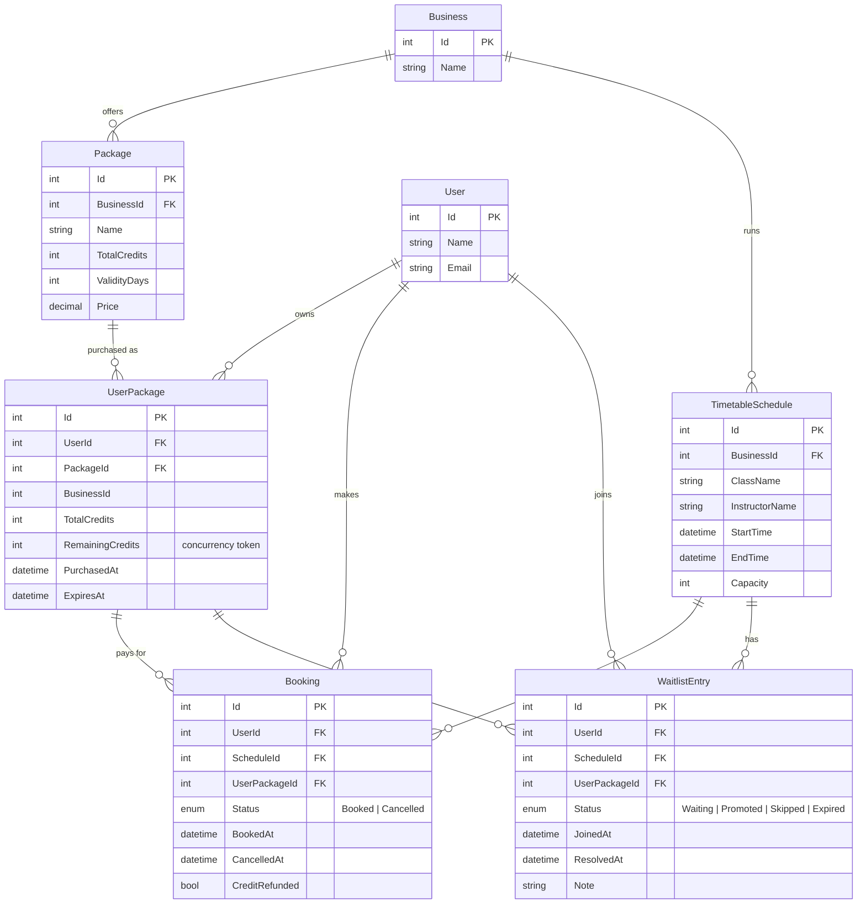

# Entity Relationship Diagram

## Indexes

- Booking (ScheduleId, Status) - attendance count per class
- Booking (UserId, Status) - overlap check per user
- WaitlistEntry (ScheduleId, Status, JoinedAt) - FIFO queue
- UserPackage (UserId, BusinessId) - wallet lookup

## Notes

- Attendance count is never stored; it is always `COUNT(Booking WHERE Status = Booked)`.
- `UserPackage.RemainingCredits` is an EF Core concurrency token (optimistic concurrency).
